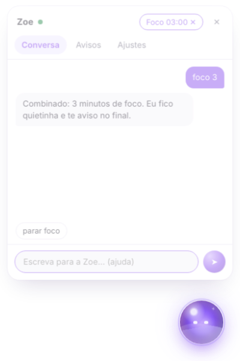

# Zoe

Uma companheira digital para o Linux: uma orbe roxa que flutua na área de trabalho, conversa, acompanha o seu dia e, nas próximas fases, também os recursos do computador.



## Estrutura

| Pasta / arquivo | O que é |
| --- | --- |
| `desktop/` | **Zoe Desktop** (Electron): janela principal (Início, Assistente, Tarefas, Foco, Relatórios, Memória, Computador, Configurações) + a orbe flutuante, balões e bandeja |
| `core/` | **Zoe Core** (Python): API local, eventos, decisões, notificações, foco, monitor do PC, memória pessoal, banco SQLite |
| `zoe.design`, `zoe-preview.html`, `zoe-fx.js` | Design da orbe e animações (usados pela Zoe Desktop) |
| `docs/ARQUITETURA.md` | Análise do projeto, escolhas de tecnologia, X11/Wayland, fases |
| `docs/API.md` | API REST e WebSocket, cascata de aprendizado, eventos, banco de dados, permissões |
| `docs/TELEFONE.md` | Arquitetura para usar a Zoe pelo telefone (gateway, pareamento, escopos) |
| `packaging/install-linux.sh` | Instala no menu de aplicativos e no início automático (sem root) |

## Instalar (executável)

**Ubuntu/Debian (.deb, recomendado):** o `apt` instala as dependências Python sozinho e cria o atalho "Zoe" no menu.

```bash
sudo apt install ./zoe-desktop_0.2.0_amd64.deb
```

**AppImage:** precisa do `libfuse2` e das bibliotecas Python.

```bash
sudo apt install -y libfuse2t64 python3-aiohttp python3-psutil
```

```bash
chmod +x Zoe-0.2.0.AppImage && ./Zoe-0.2.0.AppImage
```

No Ubuntu 22.04 o pacote se chama `libfuse2` (sem `t64`).

**Gerar os pacotes** (precisa de Node 18+): `cd desktop && npm install && npm run dist` → `desktop/dist/`.

## Não abriu? Diagnóstico

```bash
zoe --diagnostico
```

(No AppImage: `./Zoe-0.2.0.AppImage --diagnostico`.) Ele confere Python, bibliotecas, o Zoe Core, o Ollama, o sandbox e o FUSE, e imprime o comando para corrigir o que faltar. Tudo o que der errado também fica em `~/.config/Zoe/zoe.log`.

## Rodar pelo código-fonte

Requisitos: Python 3.10+, Node 18+ e um compositor (GNOME, KDE ou picom).

No Ubuntu/Debian:

```bash
sudo apt install -y python3-aiohttp python3-psutil
```

Em outras distribuições: `python3 -m pip install --user -r core/requirements.txt`.

```bash
cd desktop && npm install && npm start
```

Opcional, para conversa livre com IA local: instale o [Ollama](https://ollama.com) e baixe o modelo pela própria Zoe (Ajustes → Inteligência artificial):

```bash
curl -fsSL https://ollama.com/install.sh | sh
```

A orbe aparece no canto inferior direito. **Clique** para conversar, **arraste** para mover e use o **clique direito** para abrir o menu (ocultar, foco, pausar, parar tudo). Escreva `ajuda` para ver os comandos.

Se o Electron reclamar do *SUID sandbox* (comum no Ubuntu 24.04+), rode uma vez:

```bash
sudo chown root desktop/node_modules/electron/dist/chrome-sandbox && sudo chmod 4755 desktop/node_modules/electron/dist/chrome-sandbox
```

## Testes

```bash
cd core && python3 -m pip install --user -r requirements-dev.txt && python3 -m pytest -q
```

```bash
cd desktop && xvfb-run -a npm test
```

## Status

Prontas: **Fase 1 (Zoe Desktop)**, **Fase 2 (PC Companion)** e **Fase 3 (Personal Companion)**. As fases 4 a 6 (Guardian, Ollama, evolução) estão descritas em `docs/ARQUITETURA.md`.
