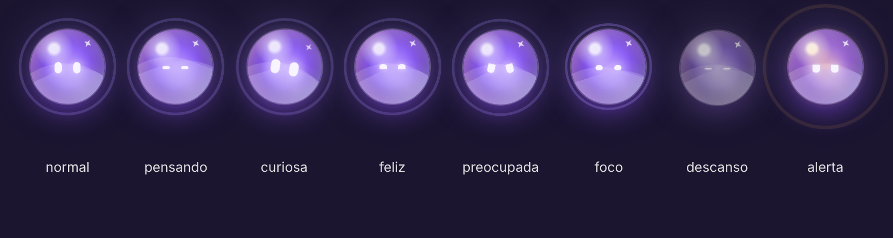

# Zoe Core — API, eventos, banco e permissões

## Conexão

O Core escuta **somente em `127.0.0.1`**, na porta 47811 (ou numa porta livre, se essa estiver ocupada). Ao iniciar, ele grava `$XDG_RUNTIME_DIR/zoe/core.json` com permissão `0600`:

```json
{ "host": "127.0.0.1", "port": 47811, "token": "…", "pid": 1234 }
```

Toda requisição precisa do token: `Authorization: Bearer <token>`, ou `?token=` no WebSocket. A API não responde a CORS, então páginas abertas no navegador não conseguem usá-la.

## REST

| Método | Rota | Corpo | Resposta |
| --- | --- | --- | --- |
| GET | `/api/health` | — | `{ok, name, version}` |
| GET | `/api/state` | — | `{settings, expression, focus, monitoring, interventions, do_not_disturb_until, uptime_s, clients}` |
| GET | `/api/settings` | — | configurações (padrões + gravadas) |
| PATCH | `/api/settings` | campos parciais | configurações atualizadas; 400 para chave desconhecida ou valor inválido |
| POST | `/api/chat` | `{text}` | `{text, expression, quick_replies[]}` |
| GET | `/api/interactions?limit=50` | — | histórico da conversa (mais antigo primeiro) |
| GET | `/api/notifications?limit=50` | — | avisos (mais recente primeiro), com `status` |
| POST | `/api/notifications/{id}/ack` | `{action}` | `dismiss` marca como lida; outra ação marca como respondida e é executada (ex.: `foco_novamente`) |
| POST | `/api/events` | `{type, payload}` | só `USER_IDLE`, `USER_RETURNED` e `USER_REQUEST` (403 para os outros) |
| POST | `/api/focus/start` | `{minutes?}` | sessão iniciada (1 a 240 min) |
| POST | `/api/focus/stop` | `{}` | `{stopped}` |
| POST | `/api/monitoring` | `{active: bool}` | estado; liga ou desliga monitoramento **e** intervenções |
| POST | `/api/emergency-stop` | `{}` | estado; para tudo e avisa |
| POST | `/api/personal-data/delete` | `{confirm: "APAGAR"}` | apaga conversas, avisos, eventos e dados pessoais |

### Configurações

| Chave | Valores | Padrão |
| --- | --- | --- |
| `nome_usuario` | texto (até 40) | `""` |
| `autonomia` | `observar` · `conversar` · `recomendar` · `intervir_com_autorizacao` · `intervir_automatico` | `conversar` |
| `frequencia` | `silenciosa` (0/h) · `baixa` (30 min, 2/h) · `normal` (10 min, 4/h) · `alta` (3 min, 10/h) | `normal` |
| `silencio_inicio`, `silencio_fim` | `HH:MM` (o período pode atravessar a meia-noite) | `23:30` – `07:30` |
| `nao_perturbe_ate` | epoch em segundos (0 = desligado) | `0` |
| `foco_minutos_padrao` | 1–240 | `25` |
| `ocioso_minutos` | 1–240 | `5` |
| `notificacoes_nativas` | bool (usa `notify-send` quando a orbe está fechada) | `true` |
| `retencao_dias` | `{system_metrics, application_usage, events, notifications}` em dias | `7, 90, 30, 30` |
| `monitoramento_ativo`, `intervencoes_ativas` | somente leitura no PATCH; mudam por `/api/monitoring` ou `/api/emergency-stop` | `true` |

## WebSocket `/ws?token=…`

Do servidor para o cliente:

| `type` | Campos | Quando |
| --- | --- | --- |
| `hello` | `state`, `expressions[]` | ao conectar |
| `state` | `state` | ajustes, foco, monitoramento ou não perturbe mudaram |
| `expression` | `name`, `ttl_ms` | `ttl_ms = 0`: expressão de fundo (foco, descanso). `> 0`: expressão passageira |
| `notification` | `notification {id, message, category, origin, expression, actions[{id,label}]}` | aviso aprovado pelas regras |
| `chat.reply` | `ref`, `text`, `expression`, `quick_replies[]` | resposta a um `chat` |
| `pong` | — | resposta a `ping` |

Do cliente para o servidor: `{type:"chat", text, ref}`, `{type:"notification.ack", id, action}` e `{type:"ping"}`.

Expressões: `normal`, `pensando`, `curiosa`, `feliz`, `preocupada`, `foco`, `descanso`, `alerta`.



## Eventos e decisões

Todo evento passa pelo `DecisionEngine` (`core/zoe_core/decision.py`). Ele escolhe **uma** ação entre `ignorar`, `aguardar`, `expressao`, `notificar`, `conversar`, `consultar_llm` e `executar`. Cada evento fica gravado na tabela `events` junto com a decisão tomada.

| Evento | Origem hoje | Regra (Fase 1) |
| --- | --- | --- |
| `FOCUS_SESSION_STARTED` | chat, bandeja, API, ação de balão | expressão de fundo `foco` |
| `FOCUS_SESSION_ENDED` | temporizador ou cancelamento | concluído: aviso com ações "Mais uma sessão" e "Pausa". Cancelado: volta a `normal` |
| `USER_IDLE` | desktop (tempo ocioso ≥ `ocioso_minutos`) | `descanso`. Durante o foco: aguarda. Com monitoramento pausado: ignora |
| `USER_RETURNED` | desktop | volta à expressão anterior; após 30 min ou mais fora, aviso espontâneo de boas-vindas (no máximo 1 a cada 2 h) |
| `EMERGENCY_STOP` | menu, ajustes, API | desliga monitoramento e intervenções e avisa |
| `MONITORING_RESUMED` | menu, ajustes, API | `feliz` passageira |
| `USER_REQUEST` | chat | registrado; a resposta vem do chat |
| `HIGH_MEMORY_USAGE`, `CPU_OVERLOAD` | Fase 2 | ainda sem regra: `aguardar` |
| `APP_USAGE_LIMIT_REACHED` | Fase 4 | ainda sem regra: `aguardar` |
| `TASK_OVERDUE`, `NEW_DISCOVERY` | Fases 3 e 5 | ainda sem regra: `aguardar` |

### Quando a Zoe pode falar sozinha

Um aviso **espontâneo** só é entregue se passar por todas estas verificações, nesta ordem:

1. autonomia diferente de `observar`;
2. frequência diferente de `silenciosa`;
3. fora do "não perturbe";
4. fora do horário silencioso;
5. não é repetido (`dedupe_key` dentro da janela);
6. abaixo do teto por hora;
7. respeita o intervalo mínimo desde o último aviso espontâneo.

Avisos de origem **usuário** (respostas, fim de um foco que o usuário iniciou, confirmação de emergência) não passam por esses limites. Avisos bloqueados ficam gravados com `status = bloqueada`. Se nenhuma orbe estiver conectada, o aviso vai para `notify-send` (D-Bus), quando permitido.

## Banco de dados

Arquivo `~/.local/share/zoe/zoe.db`, versão do esquema em `PRAGMA user_version`. As migrações ficam em `core/zoe_core/db.py` (`MIGRATIONS`).

Tabelas da seção 8 da especificação: `users`, `interests`, `personal_projects`, `personal_activities`, `books`, `tasks`, `application_usage`, `focus_rules`, `system_metrics`, `interactions`, `notifications`. Também foram criadas `events` (log de eventos e decisões) e `settings` (chave/valor JSON).

- As tabelas pessoais têm `user_id → users(id) ON DELETE CASCADE`, com chaves estrangeiras ativas.
- Há índices nas colunas de tempo e status: `idx_metrics_time`, `idx_appusage_app_time`, `idx_events_type_time`, `idx_notifications_status` e outros.
- `focus_rules.intervention_level` tem `CHECK` de 1 a 4 e é único por aplicativo.
- **Retenção:** aplicada ao iniciar e a cada 6 h, conforme `retencao_dias`. Conversas e dados pessoais não expiram sozinhos; apagam-se por "Apagar meus dados".

## Permissões e segurança

| Regra | Como é garantida |
| --- | --- |
| Nada sai do computador | Não há chamadas externas no Core. A API escuta só em `127.0.0.1` |
| Só a Zoe usa a API | Token aleatório por execução, guardado num arquivo `0600`; comparação em tempo constante |
| A interface não tem acesso ao sistema | `contextIsolation`, `sandbox`, sem `nodeIntegration`, CSP restrita; navegação e novas janelas bloqueadas |
| Sem comandos arbitrários | O IPC só repassa rotas de uma lista fixa (`API_ALLOW` em `desktop/main.js`). O Core não tem rota que execute comandos. Clientes só podem publicar 3 tipos de evento |
| Configurações validadas | Cada chave tem validador. Monitoramento e intervenções só mudam por rotas que geram o evento correspondente |
| Sem coleta invasiva | Nada de teclas, tela ou conteúdo de outros apps. Só o tempo ocioso do sistema (número de segundos) |
| Botão de emergência | Bandeja, clique direito, ajustes e API: desliga monitoramento e intervenções na hora |
| Histórico de intervenções | Tabela `events` (com a decisão) e `notifications` (com o status) |
| Apagar dados | `POST /api/personal-data/delete` com confirmação explícita |
| Processo órfão | O Core iniciado pela Zoe Desktop se encerra se ela morrer (`ZOE_PARENT_PID`) |
